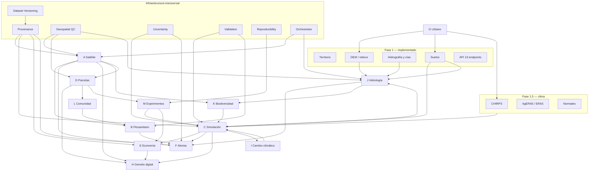

# Module Dependency Graph

**Versión:** 1.0 · **Fecha:** 2026-11-21 · **Estado:** grafo definido; módulos **no implementados**.

Dependencias entre los 13 módulos (A–M), la infraestructura transversal y los
motores de Fase 1. Una flecha `X → Y` significa «Y necesita salidas de X».

---

## 1. Grafo



---

## 2. Matriz de dependencias (fuerte = bloqueante)

| Módulo | Depende de | Bloqueantes duros | Puede empezar sin ellos |
|---|---|---|---|
| A Satélite | DEM, territorio, cuota CDSE, Provenance | Provenance | sí, con Provenance mínimo |
| B Fitosanitario | catálogo de cultivos, clima, A, reportes | catálogo, clima | sí (riesgo modelado) |
| C Simulación | suelo, clima, catálogo, parámetros | clima + suelo | no |
| D Parcelas | auth, almacén de escritura, territorio | auth | no |
| E Economía | catálogo, precios MAG, C (rendimiento) | precios | sí (costos sin C) |
| F Alertas | clima, A, B, J, umbrales | clima | sí (sequía CHIRPS) |
| G Urbano | DEM, CHIRPS, ortofoto/catastro | ortofoto | parcial |
| H Gemelo digital | A, C, D, E, clima | D + C | no |
| I Cambio climático | clima histórico, WorldClim/CMIP6, C | línea base | sí (ΔT/ΔP) |
| J Hidrología | DEM, CHIRPS, AgERA5, suelos, subcuencas | DEM + CHIRPS | sí (delimitación) |
| K Biodiversidad | A (cobertura), J (erosión), MARN (AP) | cobertura | parcial |
| L Comunidad | auth, D, B | auth | no |
| M Experimentos | C, E, D | C | sí (experimentos virtuales) |

---

## 3. Orden topológico

```
1. Infraestructura mínima (Provenance, QC, Versioning)
2. Clima (CHIRPS → AgERA5 → normales)
3. Satélite (A) y Economía (E) en paralelo
4. Simulación (C) y Fitosanitario (B)
5. Hidrología (J) y Alertas (F)
6. Parcelas (D) → Comunidad (L) → Gemelo digital (H)
7. Biodiversidad (K), Cambio climático (I), Urbano (G)
8. Experimentos (M) — puede adelantarse cuando C exista
```

---

## 4. Priorización justificada

Criterios: **datos disponibles**, **coste**, **valor científico**, **riesgo**.

| Prioridad | Módulos | Justificación |
|---|---|---|
| **P1 — ahora** | Clima (CHIRPS/AgERA5), censos, relieve | datos verificados o accesibles; sin dependencias nuevas |
| **P2 — siguiente** | A (satélite), E (economía), C (simulación maíz) | valor alto, datos disponibles, coste medio |
| **P3 — después** | B, F, J | requieren calibración y validación local |
| **P4 — condicionado** | D, L, H, G, K, I, M | dependen de auth, datos oficiales o licencias |

Detalle en `PHASE_2_IMPLEMENTATION_ROADMAP.md`.

---

## 5. Caminos críticos

1. **Clima → C → E → H**: la cadena que da valor económico real.
2. **Auth → D → L**: la cadena que da datos de campo.
3. **DEM + CHIRPS → J → F**: la cadena que da alertas hídricas.
4. **A → cobertura → K**: la cadena ambiental.

Si se rompe el clima, se detienen C, F, H e I. Por eso el clima es P1.

---

## 6. Ciclos prohibidos

- C no puede depender de E (la economía no define el rendimiento agronómico).
- B no puede depender de H (el gemelo consume alertas, no al revés).
- A no puede depender de C (la observación no se corrige con el modelo).
- M no puede depender de H.

Se verifica con `scripts/check_phase2_docs.py` (sección de grafo) y con revisión
manual en cada cambio de arquitectura.

---

## 7. Limitaciones

1. El grafo es de diseño; ninguna arista está probada en ejecución.
2. Las dependencias de datos externos (MARN, CNR, BCR) pueden bloquear módulos
   enteros.
3. La infraestructura transversal no existe aún: es requisito, no adorno.
