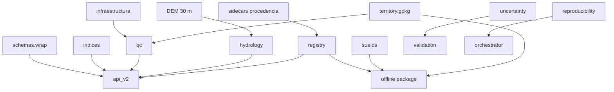

# Phase 2 Implementation Report — AGROSV

**Versión:** 2.0 · **Fecha:** 2026-11-22 · **Estado:** infraestructura transversal y
dos motores implementados y probados; módulos restantes diseñados, no implementados.

Este informe responde al encargo de Fase 2 con resultados verificables. Separa de
forma explícita lo que **se ejecutó** de lo que **solo se diseñó**. Las cifras de
pruebas de §14 se obtuvieron en este entorno y se pueden reproducir con
`.venv/Scripts/python.exe -m pytest tests -q`.

---

## 1. Estado actual del repositorio

| Elemento | Estado verificado |
|---|---|
| Artefactos de Fase 1 | territorio (`territory.gpkg`), DEM 30 m, pendiente, aspecto, hillshade, clases de relieve, infraestructura OSM, 6 rásteres de suelos |
| Procedencia | cada artefacto tiene `<archivo>.provenance.json` con hash SHA-256, licencia y resolución |
| API de Fase 1 | 13 endpoints, sin cambios; `grep -c "@app.get(" backend/agrosv/api.py` = 13 |
| API científica | 9 rutas nuevas bajo `/api/v1` (router independiente) |
| Pruebas | **161 pasan** en 16,22 s; 89 previas + 72 nuevas |
| Entorno | Python 3.14, venv en `.venv`, dependencias fijadas en `requirements.txt` |
| Documentación | 28 documentos en `docs/` (18 de Fase 2 + los de Fase 1) + 7 documentos raíz; verificación automática en `scripts/05_verify_phase2_docs.py` (OK) |

Nada de Fase 1 se eliminó ni se reescribió. El cambio en `api.py` es de dos líneas
(importación e inclusión de un router), y la prueba
`test_api_existente_no_se_elimina` sigue fijando el contrato de los 13 endpoints.

---

## 2. Funciones existentes reutilizables

| Función | Ubicación | Reutilización en Fase 2 |
|---|---|---|
| `write_manifest` / `read_manifest` | `backend/agrosv/provenance.py` | el registro de datasets **deriva** de estos manifiestos; no hay un segundo catálogo |
| `software_versions`, `sha256_file` | `backend/agrosv/provenance.py` | huella de entorno y hashes de los manifiestos de ejecución |
| `config.CRS_METRIC`, `SV_BOUNDS`, `ATTRIBUTION` | `backend/agrosv/config.py` | hidrología en UTM 16N, validación de coordenadas y atribución en paquetes |
| DEM, pendiente, hillshade (COG) | `data/processed/topography/` | insumo real del motor hidrológico y de las teselas |
| `territory.gpkg` (adm1/adm2) | `data/processed/territory/` | geometrías de los paquetes offline y QC vectorial |
| Patrón de pruebas con `require()` | `tests/conftest.py` | las pruebas nuevas se omiten si falta un artefacto, nunca pasan en falso |
| `scripts/05_verify_phase2_docs.py` | `scripts/` | puerta documental que sigue vigente |

---

## 3. Nuevos módulos diseñados

Los 13 módulos A–M están definidos en `docs/` (ver `MODULE_DEPENDENCY_GRAPH.md`).
En este ciclo se implementó su **infraestructura común** y dos motores:

| Componente | Archivo | Estado real |
|---|---|---|
| Contrato de publicación | `science/schemas.py` | **implementado** |
| Registro y versionado de datasets | `science/registry.py` | **implementado** |
| QC geoespacial | `science/qc.py` | **implementado** |
| Incertidumbre | `science/uncertainty.py` | **implementado** (Monte Carlo, cuantiles, anomalía robusta, cobertura) |
| Validación científica | `science/validation.py` | **implementado** (métricas + niveles V0–V4) |
| Reproducibilidad | `science/reproducibility.py` | **implementado** (manifiesto verificable por hash) |
| Orquestador por lotes | `science/orchestrator.py` | **implementado** (DAG, reintentos, reanudación) |
| Motor hidrológico (Módulo J) | `science/hydrology.py` | **implementado**: priority-flood, D8, acumulación, cuenca, red por umbral, LS |
| Índices espectrales (Módulo A) | `science/indices.py` | **implementado**: NDVI, EVI, NDWI, NDMI, NBR, máscara de cambio, anomalía |
| Open Data API | `backend/agrosv/api_v2.py` | **implementado** (`/api/v1`) |
| Paquetes offline | `api_v2.offline_package` | **implementado** (ZIP por departamento con manifiesto) |

**No implementado** (diseñado solamente): adquisición satelital y compuestos,
simulación de cultivos (AquaCrop/DSSAT), motor económico, fitosanitario, alertas,
gemelo digital, escenarios CMIP6, biodiversidad, contribución comunitaria,
plataforma de experimentos, autenticación y parcelas.

---

## 4. Fuentes verificadas

Registro completo con evidencia en `DATA_SOURCE_REGISTRY.md`. Verificadas con
petición real: geoBoundaries, Copernicus DEM GLO-30 (AWS), SoilGrids por WebDAV,
OpenStreetMap (Geofabrik + Overpass), Sentinel-2 L2A (Earth Search STAC + COG en
S3), CHIRPS v3, Open-Meteo, Nemotron-Personas-El-Salvador, MAG (anuarios, precios,
costos), BCR (CPV 2024, CAP 2025), SNET/MARN (PDF y atlas), subcuencas RMGIR.

De ellas, este ciclo **solo consume datos ya presentes en el repositorio**: DEM,
suelos, territorio y OSM. Las fuentes satelitales y climáticas están verificadas
como canal, pero no se descargaron escenas ni series en este ciclo.

---

## 5. Fuentes pendientes

| Fuente | Motivo |
|---|---|
| CENTA — Mapeo Digital de Suelos | portal responde 403 a cliente no navegador; sin descarga verificada |
| Subcuencas oficiales PNGIRH 2017 | disponible solo como servicio de un tercero |
| Microdatos censales (BCR) | acceso máquina-a-máquina sin validar |
| Áreas protegidas (MARN) | sin shapefile descargable verificado |
| VJ113A1/VIIRS | estado de distribución pendiente de validar |

---

## 6. Fuentes restringidas

| Fuente | Restricción |
|---|---|
| ERA5 / ERA5-Land / AgERA5 (CDS) | registro y token personal |
| Landsat, MODIS, GPM IMERG, SMAP | cuenta Earthdata |
| Sentinel Hub / CDSE | OAuth2 (el STAC público de Earth Search sí es abierto) |
| AquaCrop 7.3 | licencia FAO «All rights reserved», uso no comercial previa solicitud |
| WorldClim 2.1, GAEZ v4 | no comercial, sin redistribución |
| Google Weather | ToS prohíben archivo histórico y uso como modelo meteorológico |
| MAG / BCR | licencia de reutilización no declarada: uso interno, sin redistribución |

Consecuencia aplicada en código: los paquetes offline excluyen OSM (por
*share-alike*) y cualquier capa marcada como no redistribuible; la API publica
resultados derivados, no archivos de fuentes restringidas.

---

## 7. Dependencias técnicas

Añadidas en este ciclo: **ninguna**. La implementación usa solo lo ya fijado en
`requirements.txt` (NumPy, Rasterio, GeoPandas, Shapely, pyproj, FastAPI,
Pydantic, pytest). El relleno de sumideros usa `heapq` de la biblioteca estándar
en lugar de introducir SciPy o RichDEM; la vectorización de máscaras usa
`rasterio.features`. Sin servicios comerciales, sin GPU, sin cola distribuida.

---

## 8. Riesgos científicos

| Riesgo | Estado en el código |
|---|---|
| Presentar una estimación como medición | el contrato exige `label` y rechaza confianza alta sin cuantiles |
| Publicar resolución de visualización como resolución de dato | `resolution` es campo obligatorio; NDMI/NBR declaran 20 m |
| Convertir un índice en diagnóstico de plaga | `indices.py` no tiene ninguna ruta a diagnóstico; las fichas lo declaran |
| Cuenca calculada en una ventana presentada como cuenca completa | se detecta el contacto con el borde y se marca `truncated: true` |
| Hidrología sin calibrar presentada como caudal | toda respuesta declara «no calibrado» y V0 |
| Confundir agua física con agua autorizada | limitación textual en cada respuesta hidrológica |
| `run_id` que cambia por fecha y rompe la reproducibilidad | `run_id` = hash de contenido; la fecha se guarda aparte |
| Sobreajuste de la validación | los niveles V2–V4 exigen n mínimo y fuente declarada; no se pueden forzar |

---

## 9. Requerimientos computacionales

Medido en este ciclo: la suite completa (161 pruebas, incluidos QC de capas
nacionales, hidrología sobre ventanas del DEM y generación de paquetes offline)
tardó **16,22 s** y **19,24 s** en dos ejecuciones y no supera ~1 GB de RAM. El
endpoint de cuenca con `size_m=2000` responde en menos de un segundo en este
equipo.

**No medido:** una corrida nacional de D8 sobre las ~48 M celdas del DEM. El
bucle de acumulación es Python puro y escala mal; por eso el diseño procesa por
área de interés y el endpoint limita la ventana a 12 km de lado. Escalar a país
exige vectorizar la acumulación o usar un motor C (RichDEM/TauDEM) y volver a
medir. `docs/COMPUTATIONAL_RESOURCE_ESTIMATES.md` mantiene sus estimaciones
marcadas como no medidas.

---

## 10. Arquitectura actualizada

```
                        ┌─────────────── API ───────────────┐
  Fase 1  /api/*  ──────┤ 13 endpoints, contrato congelado  │
                        │                                   │
  Fase 2  /api/v1/* ────┤ meta · sources · provenance · qc  │
                        │ hydro/watershed · hydro/aoi       │
                        │ indices · offline/{dept}.zip      │
                        │ validation/policy                 │
                        └───────────────┬───────────────────┘
                                        │ wrap() obligatorio
                        ┌───────────────▼───────────────────┐
                        │      agrosv.science (motores)     │
                        │ schemas · registry · qc           │
                        │ uncertainty · validation          │
                        │ reproducibility · orchestrator    │
                        │ hydrology (D8) · indices          │
                        └───────────────┬───────────────────┘
                                        │ lee por ventana
                        ┌───────────────▼───────────────────┐
                        │ COG · GeoPackage · sidecars .json │
                        │ (data/processed, Fase 1)          │
                        └───────────────────────────────────┘
```

Regla aplicada: la capa `/api/v1` no lee datos por una vía nueva; usa los mismos
artefactos y manifiestos de Fase 1. El versionado de datasets se **deriva** de
esos manifiestos, de modo que no existen dos catálogos que puedan divergir.

---

## 11. Diagrama de dependencias



Diseño completo de los 13 módulos en `MODULE_DEPENDENCY_GRAPH.md`. Ciclos
prohibidos siguen vigentes (C↛E, B↛H, A↛C, M↛H).

---

## 12. Roadmap priorizado

| Ciclo | Contenido | Puerta de aceptación |
|---|---|---|
| **Hecho (este ciclo)** | infraestructura transversal + Módulo J (núcleo) + aritmética del Módulo A + `/api/v1` + paquetes offline | 161 pruebas verdes; toda salida envuelta y declarada |
| 1 | Clima histórico: CHIRPS por celda + SPI-3/6 con declaración pentadal | SPI reproducible y contraste entre productos |
| 2 | Adquisición Sentinel-2 por AOI y compuestos; NDVI/NDMI reales | escena seleccionada con `scene_id`, nubosidad declarada |
| 3 | Economía: presupuesto de maíz con precios MAG fechados | cuadre de costos y fecha/procedencia por precio |
| 4 | Simulación de cultivos (AquaCrop solo si la licencia lo permite) | corrida reproducible con hash y V1 mínimo |
| 5 | Fitosanitario y alertas sobre clima + hidrología | alerta con fuente, validez y confianza |
| 6 | Autenticación → parcelas → comunidad → gemelo digital | aislamiento por usuario probado |
| 7 | Biodiversidad, clima futuro, urbano, experimentos | cada uno con su fuente verificada |

Justificación: no se puede interpretar una anomalía de vegetación sin línea base
climática, ni simular rendimiento sin clima y suelo, ni publicar una alerta sin
series. El orden sigue el camino crítico del grafo, no la visibilidad del módulo.

---

## 13. Primer conjunto de módulos recomendado

1. **Clima histórico (CHIRPS + normales)** — datos abiertos ya verificados.
2. **Adquisición satelital por AOI** — el STAC de Earth Search no requiere clave.
3. **Economía con precios MAG fechados** — no depende de simulación de cultivos.

El motor hidrológico ya implementado se completa en ese mismo ciclo con relleno
de sumideros vectorizado y validación contra subcuencas del servicio RMGIR
(tercero verificado), que es la única referencia espacial disponible hoy.

---

## 14. Pruebas realizadas y resultados reales

Ejecutado: `.venv/Scripts/python.exe -m pytest tests -q` → **161 passed**, en dos
corridas de 16,22 s y 19,24 s. La verificación documental
(`scripts/05_verify_phase2_docs.py`) terminó con código 0.

| Archivo | Pruebas | Qué demuestra |
|---|---:|---|
| `tests/test_science_infra.py` | 30 | el contrato rechaza salidas sin limitaciones/procedencia; Monte Carlo determinista por semilla; métricas con valores analíticos; niveles V0–V4 no inflables; manifiesto detecta archivo alterado; QC detecta ráster vacío y geometría duplicada; orquestador reintenta, reanuda y detecta ciclos |
| `tests/test_hydrology.py` | 11 | D8 sobre ladera plana apunta al este; acumulación crece aguas abajo y conserva el área; la cuenca de la salida es exactamente su acumulación; no se rellena una celda sin dato; **invariantes sobre una ventana real del DEM de Fase 1** |
| `tests/test_indices.py` | 14 | NDVI/EVI/NDWI/NDMI/NBR con valores analíticos; denominador nulo → NaN (no cero); recorte a [−1, 1]; resolución efectiva 20 m declarada; máscara de cambio con umbral obligatorio |
| `tests/test_api_v2.py` | 17 | toda salida de `/api/v1` trae etiqueta, resolución, incertidumbre, limitaciones y procedencia; cuenca real en El Salvador con geometría; paquete offline con manifiesto y atribución; Fase 1 intacta |
| pruebas previas | 89 | integridad territorial, topografía, suelos, infraestructura, contrato de API, rendimiento y arquitectura documental |

**Lo que las pruebas no demuestran:** que el área de una cuenca sea correcta
frente a una delimitación oficial (no hay referencia descargable), que los
índices espectrales funcionen sobre escenas reales (no se descargaron), ni que
el motor hidrológico esté calibrado (no hay aforos). Esas carencias están
declaradas en cada respuesta de la API, no ocultas.

---

## 15. Limitaciones conocidas

1. **Hidrología no calibrada (V0).** Sin aforos ni estaciones de caudal, el
   módulo produce área aportante y escorrentía potencial, no caudales validados.
2. **Ventana de análisis.** Una cuenca mayor que la ventana se reporta truncada;
   el área es un mínimo, no el área total.
3. **Celdas planas.** El relleno de sumideros crea superficies planas donde D8 no
   tiene una dirección única; se cuantifican y se informan, no se corrigen.
4. **Acumulación en Python.** Nacional no es viable sin vectorizar; el endpoint
   limita el tamaño de ventana por esa razón, no por diseño de producto.
5. **Índices sin escenas.** La aritmética está probada; la cadena de adquisición,
   enmascarado de nubes y compuestos no existe.
6. **Paquetes offline sin ráster.** Incluyen vectorial y resúmenes; incluir el DEM
   por departamento multiplicaría el tamaño sin resolver la falta de conectividad
   en campo.
7. **Registro de fuentes parcial.** El catálogo de datasets cubre lo procesado;
   las fuentes verificadas pero no descargadas siguen solo en
   `DATA_SOURCE_REGISTRY.md`.
8. **Sin autenticación.** Por eso no hay parcelas, comunidad ni gemelo digital:
   construirlos sin control de acceso violaría la protección de datos del productor.
9. **`X-AGROSV-Provenance` vacío** en respuestas que no corresponden a un único
   artefacto (por ejemplo `/api/v1/qc`); se prefiere una cabecera vacía a una
   procedencia inventada.
10. **Estimaciones sin medir.** Todo requerimiento computacional nacional sigue
    marcado como estimación en `COMPUTATIONAL_RESOURCE_ESTIMATES.md`.
